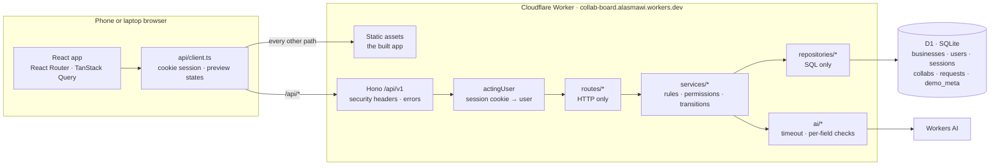
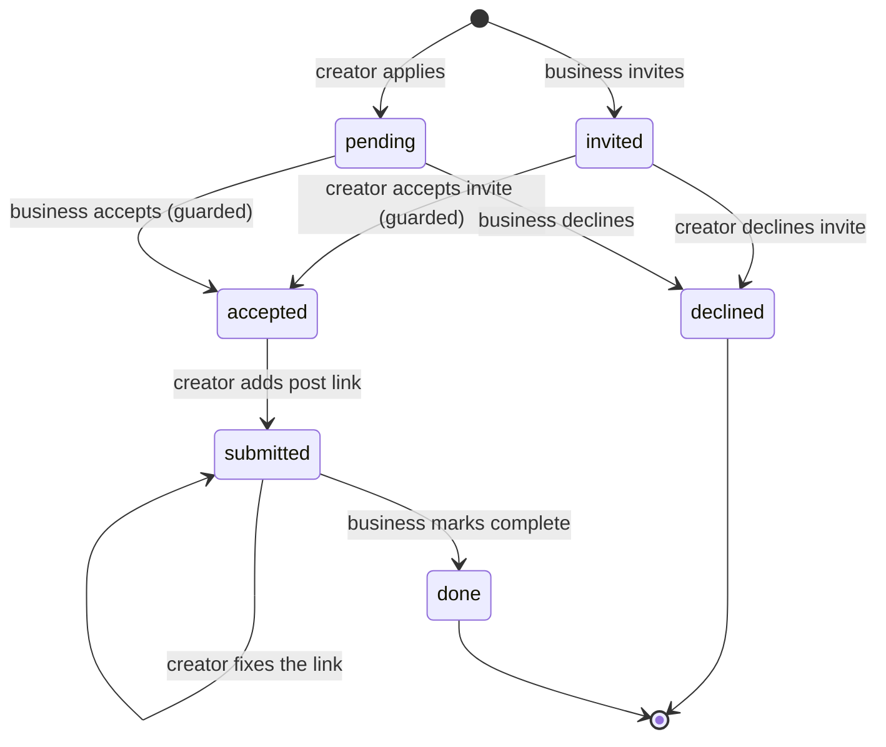
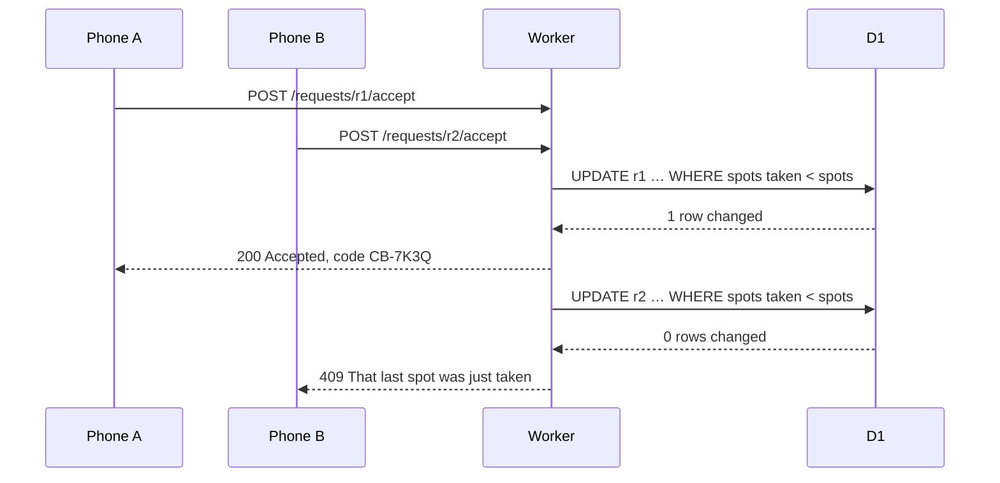
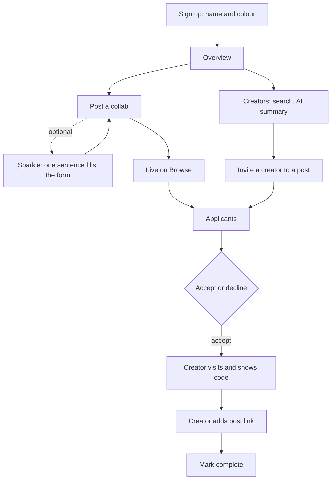
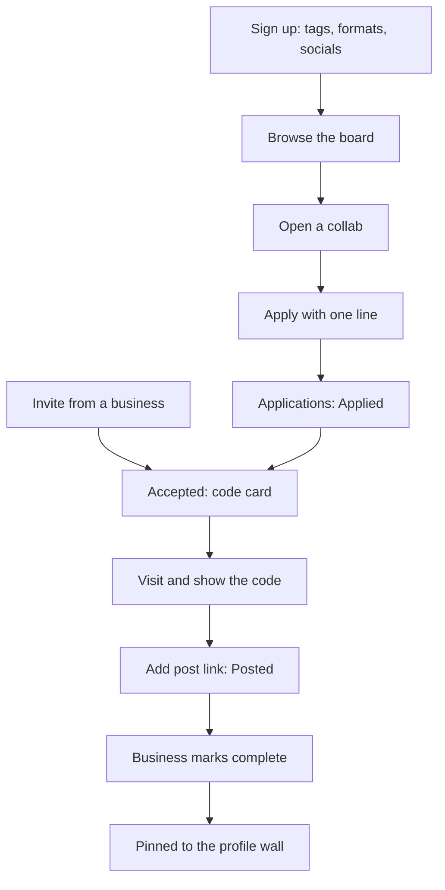

# Architecture

How Collab Board is built, how a request moves through it, and how people move through the app.
[README.md](README.md) covers running and deploying it.

## Tech stack

Everything runs on Cloudflare's free plan: one Worker serves both the app and the API from one URL.

| Layer | What | Why |
|---|---|---|
| Hosting | Cloudflare Workers with static assets | One deploy and one URL for the app and the API. Free tier |
| Database | Cloudflare D1 (SQLite) | Free, close to the Worker, and a single SQL statement is atomic, which the spot rule relies on |
| AI | Workers AI, `llama-3.3-70b-instruct-fp8-fast` | Fills the post form from a sentence and writes creator summaries. Free daily allowance |
| API | Hono 4 on the Worker, under `/api/v1` | Small, typed routing for Workers |
| Validation | Zod 4 | One schema checks a request on the server and a form in the browser |
| App | React 19, React Router 7 | Screens and navigation |
| Data in the app | TanStack Query 5 | Caching, refetching and loading or error states |
| Build | Vite 8 with `@cloudflare/vite-plugin` | Runs the real Worker and D1 locally during `npm run dev` |
| Fonts | Ultra (titles), Archivo (text), JetBrains Mono (codes) | Bundled with the app, so they need no network |
| Language | TypeScript 5.9 | Shared types between the Worker and the app |
| Tests | Vitest 5 with `@cloudflare/vitest-plugin` | Tests run inside the real Workers runtime against real D1. Nothing is mocked |
| Screen checks | playwright-core | Visits every screen at five widths in every state |
| Lint | ESLint 10 with typescript-eslint | |
| CI | GitHub Actions | Runs `npm run check`, then deploys on push to `main`. Not run yet, because nothing is pushed |

## System

`wrangler.jsonc` sends `/api/*` to the Worker first. Every other path is the app, which falls back to
`index.html` so links to any screen work.

## Layers

| Layer | Folder | Does | Never does |
|---|---|---|---|
| Routes | `src/worker/routes` | Reads the request, validates it with Zod, calls one service, returns JSON | Business rules or SQL |
| Services | `src/worker/services` | Who may do what, which status changes are allowed, what errors mean | SQL or HTTP |
| Repositories | `src/worker/repositories` | SQL, including the single-statement guards | Decide permissions |
| AI | `src/worker/ai` | Calls the model with a timeout, keeps only fields that pass their schema | Write to the database without a person's review |
| Shared | `src/shared` | Types, schemas, statuses, dates and labels used by both sides | Import from the Worker or the app |
| App | `src/web` | Screens (`routes`), features, components and design tokens | Trust its own checks: the server checks everything again |

## Data

| Table | Holds |
|---|---|
| `businesses` | Name and colour ("house") |
| `users` | One row per account. A business account links to its business, and a unique index allows only one per business |
| `sessions` | Hashed session tokens. The cookie holds the token, the database holds only its hash |
| `collabs` | A business's post: what's offered, what to post, spots, end date, and optional details |
| `requests` | An application or an invite, with its status, pitch, code and post link |
| `demo_meta` | When the demo was last reset. Resetting needs the secret `DEMO_RESET_TOKEN` |

Spots taken, spots left and whether a collab is open, full or ended are worked out when read, never
stored, so they can't fall out of step.

## Status of an application

On screen, `pending` reads as Applied, `submitted` as Posted and `done` as Completed. Each status has its
own stamp.

## The spot rule

A collab never accepts more creators than it has spots, even with a double tap or two phones at once.

The count and the update are one SQL statement in `requestsRepo.acceptIfSpotAvailable`, and D1 runs
one write at a time, so nothing can slip between them. Accepting an invite, applying and lowering the
spots on a post use the same pattern.

## How people use it

### A business

### A creator

## Design system in the code

| Piece | Where | Rule |
|---|---|---|
| Colours and type | `src/web/design/tokens.css` | Cream, red and ink. Ultra for titles only |
| Business colour | `.house--*` in `app.css` | Five colours, picked at sign-up |
| Awning | `::before` on `.post-card`, `.brand-banner`, `.wall__card` | The business's colour striped with a pale tint, with a scalloped edge |
| Tilt | `rotate: var(--tilt)` | A fixed angle per card from its id. Ended posts sit straight, and so does everything with Reduce Motion on |
| Stamps | `src/web/components/Stamp.tsx` | One per status, plus Last spot, Full and Ended. Real text, so screen readers read them |
| Businesses and creators | `BrandMark`, `Ring` | A business is always a square, a creator always a round ring |

## Checks

| Command | What it proves |
|---|---|
| `npm run check` | Types, lint and 249 tests in the real Workers runtime, including the spot race with the guard deliberately broken |
| `npm run test:ui` | 300 screen checks: every screen at 320, 360, 390, 768 and 1280px in every state, with no sideways scroll |
| `npm run deploy` | Builds, applies migrations to the live D1, then deploys |
