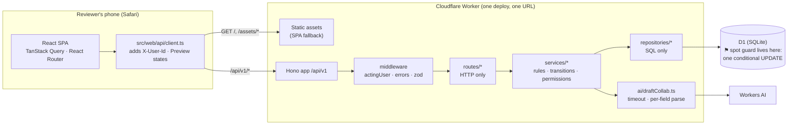
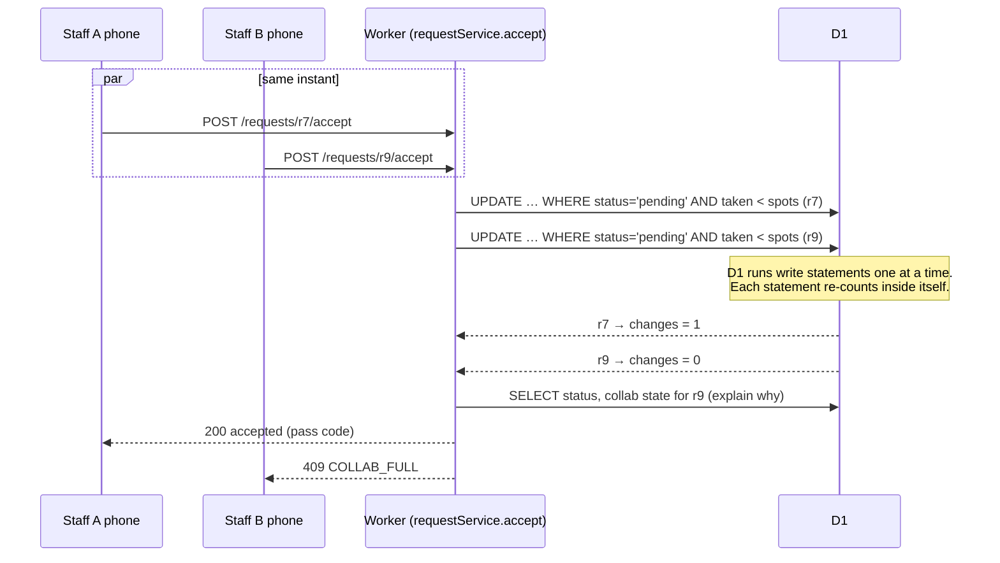
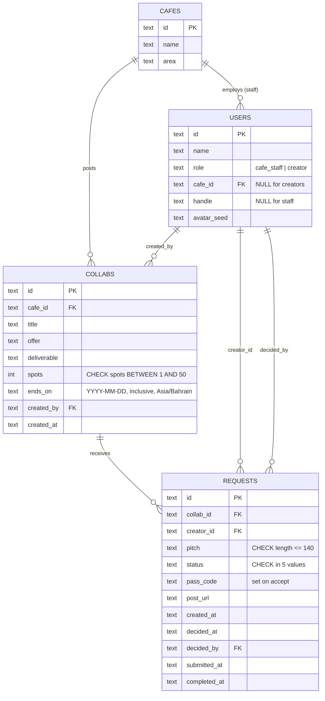
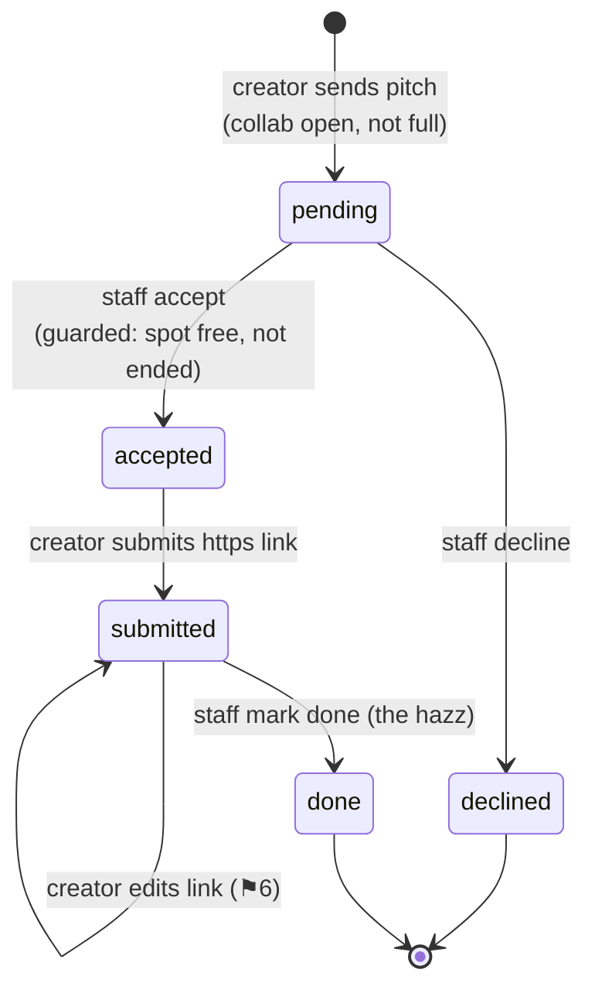
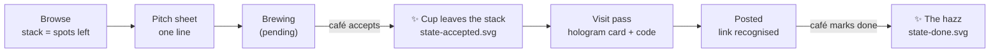
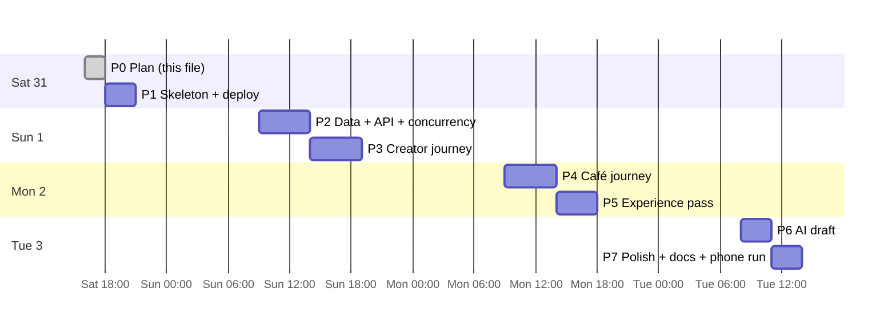

# PLAN — Finjan · فنجان (Barada Collab Board)

> Phase 0 deliverable. No application code exists yet. Every section ends in something checkable.
> Items marked **⚑ FLAG** are places where the build prompt conflicts with the brief, with current Cloudflare
> tooling, or with itself. Each one has a recommended default so work can start once this is approved.

---

## 1. Requirements trace

Every sentence of the brief (§12 of the build prompt), mapped to where it is built and how it is verified.

| # | Brief sentence | How / where it is satisfied | Verified by |
|---|---|---|---|
| B1 | "A café wants creators to visit and post about it. Build the small app that makes that happen." | Two journeys on one Worker: café (`/cafe/*`) and creator (`/`, `/collabs/*`, `/me/*`). | Demo script in README, run on a phone |
| B2 | "Café: posts a collab (title, what's offered, what to post, number of spots, end date)." | `POST /api/v1/collabs` → `collabService.create` → `collabsRepo.insert`. Form at `/cafe/collabs/new` with the shared Zod `CollabInput` schema. | `collabs.test.ts` (create + validation), manual |
| B3 | "Sees who asked to join, then accepts or declines." | Inbox `/cafe/collabs/:id`, `GET /collabs/:id/requests`, `POST /requests/:id/accept|decline`. | `transitions.test.ts`, `permissions.test.ts`, manual |
| B4 | "Creator: browses collabs on their phone" | Feed `/` (`GET /collabs?state=open`), designed at 360px. | Playwright screenshot at 360 + 390, manual iPhone |
| B5 | "asks to join with a one-line pitch" | Pitch bottom sheet, ≤140 chars, `POST /collabs/:id/requests`. Insert is atomic and idempotent (§5.3). | `requests.test.ts` (length, duplicate, ended, full) |
| B6 | "gets accepted" | Status `accepted` + pass code set in the same guarded UPDATE. "My collabs" shows it, with the accepted moment. | `concurrency.test.ts`, manual |
| B7 | "visits" | **Visit pass** screen `/me/passes/:requestId`: café, offer, what to post, deadline, pass code. A screen, not a DB state. | Manual demo step: staff matches code in inbox |
| B8 | "then submits the link to their post" | `POST /requests/:id/submission` with an https URL; Instagram/TikTok detected and labelled. | `transitions.test.ts`, `postLink.test.ts` (unit) |
| B9 | "The café marks it done." | `POST /requests/:id/complete` (submitted → done), hazz animation. | `transitions.test.ts`, manual |
| R1 | "Cloudflare (Workers, D1, frontend on Cloudflare, free tier)" | One Worker with static assets + D1 + Workers AI. No paid features (no Durable Objects needed, no Queues). | `wrangler.jsonc` review; deployed URL |
| R2 | "works end to end on the live link, tried on reviewers' own phones" | Deploy from Phase 1; GitHub Actions deploys `main`. Rich seed + Reset demo + one phone can play both roles. | Live smoke test after every phase (§9) |
| R3 | "mobile first, feels good on an iPhone at 360px" | Layout built at 360px; tap ≥44px; inputs ≥16px; safe-area insets; bottom sheets and sticky action bars. | Playwright at 360/390 (no horizontal scroll check), real iPhone pass in Phase 7 |
| R4 | "login can be faked" | Switch-user sheet → `X-User-Id` header. The server loads the user and enforces role + café ownership on every write. | `permissions.test.ts` |
| R5 | "a collab never accepts more creators than it has spots, even with a double tap or two staff accepting at the same moment — write a test for it" | Single conditional UPDATE in `requestsRepo.acceptIfSpotAvailable` (§5.1). The same guard covers new requests and reducing spots. | `concurrency.test.ts` (race, double tap, two staff, 20× loop, edit-vs-accept) |
| R6 | "every screen has an empty, a loading and an error state" | Shared `<ScreenState>` component (loading skeleton / empty / error with retry) used by every route. Preview states in the demo menu let reviewers trigger each one. | State matrix §6, Playwright run per screen × forced state |
| R7 | "it should look like its own product, not a default template" | Finjan concept, brand assets, tokens, custom components only, product voice (§7). | Anti-template checklist per screen in Phase 5 |
| X1 | Bonus: "café types one sentence, AI fills the collab form, café edits before publishing" | `POST /ai/draft-collab` → Workers AI → per-field Zod parse → partial draft fills the form. Never publishes. | `ai-draft.test.ts` |
| X2 | "if the AI fails or returns nonsense, the café must never get stuck" | 8s timeout, always 200 with whatever is valid, "Skip, I'll type it" always visible (also while loading), cancel aborts the request. | `ai-draft.test.ts` (prose, partial, empty, timeout, throws) + manual with Preview → force error |
| V1 | "Review: read like a pull request — structure, naming, tests, and whether the next person could pick it up." | Layering routes → services → repositories; README, DECISIONS.md, `npm run check`, CI. | CI green; README "first run" works on a clean clone |

---

## 2. Assumptions and open questions

### 2.1 Assumptions (from §13, logged in DECISIONS.md as they change)

- One request per creator per collab (`UNIQUE(collab_id, creator_id)`). Declined is final. No withdraw.
- `ends_on` is an inclusive date in Asia/Bahrain (UTC+3, no daylight saving, so "today" is just `now + 3h`).
- After `ends_on`: no new requests. Accepted creators can still submit their link.
- Accepted spots stay taken through `submitted` and `done`. No releasing no-shows in v1.
- Post link: any `https://` URL. Instagram / TikTok are recognised and labelled. Others say "Your post".
- No notifications, uploads, payments or real auth. English UI, logical CSS properties (`margin-inline`, etc.) so RTL works later.

### 2.2 Things I noticed (flags, with the default I'll use)

| # | Issue | Options | Default |
|---|---|---|---|
| ⚑1 | **Seed data in a migration goes stale.** `0002_seed.sql` with fixed dates means every collab is "ended" a week after the review. | (a) static SQL seed, (b) **TypeScript seed that writes dates relative to today in Bahrain**, run by `POST /demo/reset` and on first boot if the DB is empty | **(b)**. `migrations/` holds schema only; seed lives in `src/worker/demo/seed.ts`. This changes the §14 layout. |
| ⚑2 | **"One café" (§13) vs. "staff of another café can't act" (§7 test 5).** One café can't show the cross-café rule. | (a) one café, test-only second café, (b) **3 seeded cafés**, Barada has 2 staff | **(b)**. Barada Café (2 staff: for the "two staff" demo), plus 2 neighbours so the feed has variety and the rule is visible. |
| ⚑3 | **The accept SQL in §7 takes `:collabId` as a separate parameter.** If a caller passes the wrong collab, the guard counts the wrong collab. | Keep as is, or **use a correlated subquery on the row's own `collab_id`** | **Correlated subquery** (§5.1). One less parameter that can be wrong. |
| ⚑4 | **Reset demo while several reviewers are testing at once.** Reviewer A resets → reviewer B's pass disappears mid-flow. | (a) global reset + confirm sheet + "Last reset 2 min ago" note, (b) per-device demo spaces (each phone gets its own copy of the data, in a `space_id` column), (c) no reset | **(a)** for v1: simple and honest. (b) is more robust but puts a `space_id` into every query and makes the code noisier for reviewers. I'll write it up in DECISIONS.md as the next step. **Tell me if you'd rather have (b).** |
| ⚑5 | **Accepting after `ends_on`.** The brief doesn't say. | Allow, or **block with 409 `COLLAB_ENDED`** | **Block.** The visit window is closed, so a new spot can't be used. Pending requests on an ended collab show "Closed" in the inbox. Decline still works. |
| ⚑6 | **Re-submitting a link.** Typos happen. | Final on first submit, or **editable while `submitted`** | **Editable while `submitted`**, locked once `done`. |
| ⚑7 | **Double tap on "Send pitch".** The UNIQUE constraint would turn the second tap into an error. | 409, or **idempotent 200 returning the existing request** | **Idempotent 200** (same as double-tap accept). |
| ⚑8 | **Preview states: client or server?** | (a) **client-side in `src/web/api/client.ts`** (delay / throw / empty), (b) a server header | **(a)**. The server stays clean. Error previews still use the real error envelope shape. Stored in `sessionStorage`, only shown in the demo menu. |
| ⚑9 | **Feed content for full / ended collabs.** | Hide, or show dimmed | Feed = open collabs first, then a "Fully poured" section (full, not ended). Ended collabs are hidden from the feed but still in "My collabs". |
| ⚑10 | **Fonts from Google Fonts** (tokens.css `@import`). Small risk on slow venue Wi-Fi. | Keep Google Fonts, or self-host the woff2 files | Keep, with `display=swap` and `<link rel="preconnect">`. Self-host only if Phase 7 shows a problem. |

### 2.3 Questions for Barada (non-blocking; defaults above apply until answered)

1. Should a café be able to release a no-show's spot? (v1: no)
2. Is one request per creator per collab right, or can a declined creator try again?
3. Should creators see collabs that are already full?

---

## 3. Risks and mitigations

| Risk | Impact | Mitigation |
|---|---|---|
| **⚑ This cloud container can't reach `api.cloudflare.com`** (the network policy denies the host), so I can't run `wrangler deploy` from here. | Blocks Phase 1 deploy | **Recommended:** deploy from **GitHub Actions** on push to `main`, using `CLOUDFLARE_API_TOKEN` + `CLOUDFLARE_ACCOUNT_ID` repo secrets. This also gives "main is always deployed". Alternatives: allow the host in the environment's network settings and add the token as an environment secret, or you run `npm run deploy` locally. **Needs one action from you (§9, Phase 1).** |
| D1 database must exist before the first deploy | Deploy fails | One-time `wrangler d1 create finjan` (via CI step or locally); id goes in `wrangler.jsonc`. Migrations run in CI before `wrangler deploy`. |
| D1 migration applied in the wrong order / forgotten | Live 500s | CI runs `wrangler d1 migrations apply --remote` before deploy; `/api/v1/health` checks the schema version. |
| Workers AI has no local emulation (the binding always calls the real service) and limited free usage (10k neurons/day) | Tests flaky; AI unavailable during demo | AI goes through a small `AiClient` interface. Tests inject fixtures, never the real model. In production, any failure → empty draft + warning (§8). |
| Model doesn't follow the JSON format | Junk in form | JSON mode (`response_format`) **and** per-field `safeParse`; anything invalid is dropped and listed as "couldn't fill". |
| `@cloudflare/vitest-pool-workers` version coupling (current 0.23 needs Vitest ^4.1) | Test setup breaks | Pin exact versions in `package.json`; `npm run check` in CI from day one. |
| iOS: input zoom, 100vh bugs, sticky bars under the home indicator, rubber-band scroll in sheets | Feels broken on reviewers' phones | 16px inputs, `100dvh`, `env(safe-area-inset-*)`, `overscroll-behavior: contain` in sheets, `viewport-fit=cover`. Real iPhone check in Phase 3, 4 and 7. |
| View Transitions API not available everywhere | Missing motion | Feature-detect; plain CSS transitions as fallback; nothing depends on it. |
| Reviewers reset at the same moment as others are testing | Confusing data | Confirm sheet, "last reset" note, rich seed so resetting is rarely needed (⚑4). |
| Concurrency test passes locally but proves less than it seems | Reviewer distrust | The test fires real HTTP requests at the Worker in parallel (`Promise.all` over `SELF.fetch`), not repository calls. The README explains *why* it holds in production too: D1 runs one write statement at a time on the primary database, and the guard is one statement. |

---

## 4. Architecture



- **Routing:** `wrangler.jsonc` → `assets.not_found_handling: "single-page-application"` and `run_worker_first: ["/api/*"]`, so API calls never hit the SPA fallback.
- **Same origin:** no CORS, one URL to share.
- **Acting user:** `actingUser` middleware reads `X-User-Id`, loads the user from D1 (unknown id → 401 `UNKNOWN_USER`) and puts it on the context. Services take it as an explicit `actor` argument, so permissions are plain function logic that can be tested.
- **Errors:** services throw `DomainError(code, status, message)`; one error handler turns it into `{ error: { code, message } }`. Unknown errors → 500 `UNEXPECTED` with a friendly message (the stack is logged, never returned).

### 4.1 Accept: request flow and where the guard sits



---

## 5. Data model and status machine



Changes from §6 of the prompt:
- `CHECK` constraints on `role`, `status`, `spots BETWEEN 1 AND 50` and `length(pitch) <= 140`, so the database rejects bad data even if a service has a bug.
- `CHECK (role = 'cafe_staff') = (cafe_id IS NOT NULL)`: staff always belong to a café, creators never do.
- Index `requests(collab_id, status)` for the guard's count, and `requests(creator_id)` for "My collabs".
- IDs: short prefixed random ids (`col_…`, `req_…`) made in TypeScript. Readable in logs and tests.
- `pass_code`: 4 characters from an alphabet without look-alikes (no 0/O/1/I), shown as `FJ-7K3Q`. It doesn't need to be unique: staff check it against the creator's name in their own inbox.

### 5.0 Status machine



| Action | Allowed from | Same action twice | Anything else |
|---|---|---|---|
| accept | pending | 200 (idempotent) | 409 `INVALID_TRANSITION`, or `COLLAB_FULL` / `COLLAB_ENDED` |
| decline | pending | 200 | 409 |
| submit link | accepted, submitted | 200 (updates link) | 409 |
| complete | submitted | 200 | 409 |

Derived, never stored: `spots_taken` = count in (accepted, submitted, done); `spots_left`; collab state `ended` (today > ends_on) → `full` (left = 0) → `open`.

### 5.1 The guard (`requestsRepo.acceptIfSpotAvailable`)

```sql
-- One statement on purpose: D1 runs a write statement atomically, so the count and
-- the update can't be split by another request. Never "SELECT count, then UPDATE".
UPDATE requests
SET status = 'accepted', decided_at = ?1, decided_by = ?2, pass_code = ?3
WHERE id = ?4
  AND status = 'pending'
  AND (SELECT ends_on FROM collabs WHERE id = requests.collab_id) >= ?5   -- today, Bahrain
  AND (SELECT COUNT(*) FROM requests AS taken
       WHERE taken.collab_id = requests.collab_id
         AND taken.status IN ('accepted', 'submitted', 'done'))
      < (SELECT spots FROM collabs WHERE id = requests.collab_id);
```

`meta.changes = 1` → accepted. `0` → re-read and explain: already accepted (200), declined (409 `INVALID_TRANSITION`), ended (409 `COLLAB_ENDED`), otherwise 409 `COLLAB_FULL`.

### 5.2 The same idea for the other two writes that touch spots

- **Reduce spots** (`collabsRepo.updateIfSpotsCoverTaken`): `UPDATE collabs SET … WHERE id = ? AND ?spots >= (SELECT COUNT(*) …taken…)` → 0 changes = 409 `SPOTS_BELOW_TAKEN`. Because this and accept are both single statements, "edit spots down while someone accepts" can't break the invariant either. That case gets its own test.
- **New request** (`requestsRepo.insertIfCollabOpen`): `INSERT … SELECT … WHERE ends_on >= today AND taken < spots` (with `ON CONFLICT(collab_id, creator_id) DO NOTHING`), then explain 0 changes: duplicate → return the existing request (⚑7), ended → 409 `COLLAB_ENDED`, full → 409 `COLLAB_FULL`.

---

## 6. Screen inventory and state matrix

Every screen uses `<ScreenState>`: **loading** = a skeleton shaped like that screen (with `state-loading.svg` only for full-page loads), **empty** = `state-empty.svg` + reason + next action, **error** = `state-error.svg` + what happened + **Try again** button (re-runs the query).

| Screen | Success | Empty | Loading | Error |
|---|---|---|---|---|
| **Landing / switch user** `/welcome` | `scene-serve.svg` hero, "Every cup is a spot.", users grouped "I run a café" / "I make content" | — (seed always has users; if not: "The majlis is empty. **Reset demo** to set the table.") | Three user-row skeletons | "We couldn't seat you. Check your connection — **Try again**" |
| **Browse feed** (creator) `/` | Collab cards: café, offer as headline, cup stack, "Ends in 3 days" | "Nothing brewing yet — cafés post new collabs every week. **Check back soon**" | 3 card skeletons with a ghost stack | "The feed spilled. **Try again**" |
| **Collab detail + pitch sheet** `/collabs/:id` | Offer, what to post, deadline, stack; sticky **Ask to join** | n/a (single item) → missing id: "This collab has been cleared away. **Back to the feed**" | Detail skeleton | "Couldn't pour this one. **Try again**" |
| ↳ Pitch sheet | Single line, `92/140`, example chips; **Send my pitch** | — | Button: "Pouring…" (disabled, no double send) | Inline: "Didn't send — your pitch is still here. **Try again**"; full: "All cups are taken — this one filled up while you were writing." |
| **My collabs** (creator) `/me` | Sections: Your cup's ready (passes) · Brewing · Posted · Served · Not this time | "You haven't asked for a cup yet. **Browse collabs**" | List skeleton | "Couldn't find your cups. **Try again**" |
| **Visit pass** `/me/passes/:id` | Tilting hologram card: collab cup filled, café, offer, what to post, deadline, `FJ-7K3Q`; sticky **I've posted — add link** | Not accepted yet: "This pass is still brewing. We'll pour it when the café says yes." | Card-shaped skeleton | "The pass didn't load. **Try again**" |
| **Submit post** (sheet from pass) | URL field, detected "Instagram post ✓"; **Send link** | — | "Sending…" | Bad URL: "That doesn't look like a link — it should start with https://". Server: "Didn't send. **Try again**" |
| **Café: my collabs** `/cafe` | Cards with stack, "3 brewing" badge; **Post a collab** | "No collabs on the menu yet. **Post your first collab**" | Card skeletons | "Couldn't open the menu. **Try again**" |
| **Café: create / edit** `/cafe/collabs/new`, `/:id/edit` | AI sentence box (top) + form; **Publish collab** / **Save changes** | — | Edit: form skeleton. AI: "Reading your sentence…" + **Skip, I'll type it** | Save: field errors inline; `SPOTS_BELOW_TAKEN`: "4 creators already have cups — spots can't go below 4." AI: "The AI couldn't help this time — the form is all yours." |
| **Café: inbox** `/cafe/collabs/:id` | Stack at top; tabs Brewing / Accepted / Posted / Served / Declined; large **Accept** / **Not this time** | "No pitches yet. Creators see this collab in their feed — they usually arrive within a day." | Pitch card skeletons | "The inbox didn't load. **Try again**" |
| **Global** | Toasts, offline banner ("You're offline — we'll catch up when you're back"), demo menu (role chip, Reset demo, Preview states) | — | — | Reset failed: "Reset didn't finish. **Try again**" |

Preview states in the demo menu: **Normal · Slow (3s) · Error · Empty**. "Empty" makes list queries return `[]` on the client only.

---

## 7. Experience spec

### 7.1 Concept
**Finjan · فنجان — the stack and the dallah.** Spots are cups in a stack; accepting lifts a cup onto the tray; full = no cups left; done = the hazz. Gold-line hologram on deep ink. Assets in `/brand` are used as they are, not redrawn (`stackSVG`, `cupSVG`, `FinjanStack.tsx`, `state-*.svg`, `scene-serve.svg`).



### 7.2 Signature moments (6)

1. **Browse feed** — each card shows its own foil pattern (seeded by collab id) and a live cup stack. Cards press in (`scale(.98)`) on tap.
2. **Pitch sheet** — rises from the bottom; character count turns qahwa near 140; chips fill the input; after sending, the sheet folds into a "Brewing" chip that flies to the My-collabs tab.
3. **Accepted → visit pass** — the first time a creator opens an accepted request, `state-accepted.svg` plays once, then the pass card fades in. The card tilts with touch-drag (CSS `perspective`, 3 layers at different depths); with Reduce Motion it stays flat.
4. **Submit your post** — paste → the field recognises Instagram / TikTok and shows a label chip as you type.
5. **Café inbox** — Accept → the newest cup animates onto the tray (`FinjanStack` `animateLast`) at once (optimistic update; on 409 it rolls back with "That last cup was just taken by a teammate."). Full collab shows the ghost cup and full tray.
6. **Mark done** — `state-done.svg` (hazz + cardamom check) plays in place; the collab gains a "Served posts" list.

### 7.3 Tokens
Use `brand/tokens.css` as is (colour, status, type, space, radius, motion). Additions in `src/web/design/tokens.css`:
- `--safe-top/bottom: env(safe-area-inset-*)`, `--bar-h: 72px` (sticky action bar)
- `--z-bar: 10; --z-sheet: 20; --z-toast: 30`
- `--shadow-sheet`, `--press-scale: .97`
- Focus: `outline: 2px solid var(--fj-gold-hi); outline-offset: 2px` + `--fj-glow` (no browser default ring).

### 7.4 Voice
Warm, short, hospitable; coffee words used lightly, never in a way that hides meaning. Errors say **what happened + what to do**.

| Generic | Finjan |
|---|---|
| Submit | Send my pitch · Publish collab |
| No data | Nothing brewing yet — check back soon |
| Error occurred | The feed spilled. Try again |
| Request accepted | Your cup's ready — show this pass at the counter |
| Collab is full (409) | All cups are taken — this one filled up while you were writing |
| Loading… | Pouring… |
| Mark as complete | Mark served |

---

## 8. Test plan

All on real D1 (SQLite in workerd) via `@cloudflare/vitest-pool-workers`, calling the Worker over HTTP (`SELF.fetch`) unless marked *unit*.

**`test/concurrency.test.ts`** (the one reviewers open first — written to read at a glance)
- `accepts exactly 2 of 5 when 5 staff accept at once on a 2-spot collab`
- `treats a double tap on accept as one acceptance and answers both taps with 200`
- `lets only one of two staff take the last spot`
- `keeps the spot count correct across 20 repeated races` (loop of the first test)
- `never lets a spots reduction and an accept together exceed spots`
- `stops new requests once a collab is full`

**`test/transitions.test.ts`**
- happy path pending → accepted → submitted → done
- each illegal transition → 409 `INVALID_TRANSITION` (table-driven)
- accept after `ends_on` → 409 `COLLAB_ENDED`; request after `ends_on` → 409
- creator can edit link while submitted, not after done; non-https rejected

**`test/permissions.test.ts`**
- creator can't accept / decline / complete / create collab → 403 `FORBIDDEN`
- staff of another café can't see requests, accept, edit or complete → 403
- creator can't submit for someone else's request → 403
- missing / unknown `X-User-Id` → 401

**`test/ai-draft.test.ts`** (fixture `AiClient`, no network)
- valid JSON → all fields; partial JSON → valid fields + `unfilled` list
- prose / empty / non-JSON → 200, empty draft, warning
- timeout (fake timers) and thrown error → 200, empty draft, warning
- clamps spots to 1–50; drops past dates; "this month" → last day of the month (Bahrain)

**Unit:** `postLink.test.ts` (Instagram/TikTok/other/invalid), `bahrainDate.test.ts`, `collabState.test.ts`.

**UI smoke (Playwright, local, Phase 3+):** each route at 360 and 390 px × {normal, slow, error, empty}; asserts no horizontal scroll and that the error state has a retry button. Run manually, not in CI.

`npm run check` = `tsc --noEmit` + ESLint + Vitest. CI runs it on every push.

---

## 9. Phase plan and time budget

Today is **Sat 31 Oct**; due **Tue 3 Nov**.



| Phase | Output | Stop & review |
|---|---|---|
| 1 | Vite + Hono Worker, assets routing, D1 bound, tokens, styled placeholder (`scene-serve.svg` + lockup), CI with `npm run check` and deploy | **Needs from you:** Cloudflare API token + account id as GitHub secrets (or another option in §3). Live `*.workers.dev` URL. |
| 2 | Schema migration, TS seed, repositories, services, routes, switch-user, reset | Concurrency tests green |
| 3 | Feed, detail + pitch sheet, My collabs, visit pass, submit link — all 4 states | Deployed, checked at 360 |
| 4 | Café list, create/edit, inbox, accept/decline, mark done — all 4 states | Deployed |
| 5 | Signature moments, motion, copy review, anti-template checklist per screen | Screenshots |
| 6 | AI draft endpoint + UI + tests | Tests green, failure path shown |
| 7 | README (live link, 2-minute demo script, setup, tests, deploy), DECISIONS.md, final iPhone pass | Done list (§16) |

**Cut order if time runs short:** AI bonus → celebration animations (keep static art) → link recognition → pass tilt.
**Never cut:** the invariant and its tests, the four states, mobile quality, the live deploy.

### Planned repo layout (with the ⚑1 change)

```
/brand                       finjan-assets (unchanged)
/src/worker   index.ts, routes/, services/, repositories/, ai/, demo/seed.ts, http/errors.ts
/src/shared   schemas.ts (zod), status.ts, dates.ts
/src/web      routes/, components/, features/{collabs,requests,pass,ai}/, design/, api/
/migrations   0001_init.sql
/test         concurrency, transitions, permissions, ai-draft (+ unit tests)
PLAN.md  DECISIONS.md  README.md  wrangler.jsonc  .github/workflows/ci.yml
```
