<p align="center"></p>

# Collab Board

A mobile-first board where local businesses post collabs and content creators apply. A business
offers something, such as a meal, a class or a product, in exchange for a post. Creators apply in
one line, the business accepts the ones it wants, the creator visits and posts, and the business
marks it complete.

| | |
|---|---|
| **Live** | https://collab-board.alasmawi.workers.dev |
| **Runs on** | Cloudflare Workers, D1 and Workers AI, free plan, no running cost |
| **Checks** | 265 automated tests · 300 screen checks · 0 known vulnerabilities in runtime dependencies |
| **Owner** | Abdulla Alasmawi |

**Contents:** [What it does](#what-it-does) · [Features](#features) · [Try it](#try-it) ·
[Decisions, cuts and AI tools](#decisions-cuts-and-ai-tools) · [Architecture](#architecture) · [Reviewer questions](#reviewer-questions) · [Known gaps](#known-gaps) ·
[Run it](#run-it) · [Documentation](#documentation)


## What it does

<p align="center"></p>

Two kinds of account use one board. A **business** is always shown as a square in its own colour,
and a **creator** as a round ring drawn from their tags, so the two sides can't be confused.

## Features

<p align="center"></p>

| Area | Feature | What it does | Evidence |
|---|---|---|---|
| Business | Business account | One account per business, with its name and colour | [`test/auth.test.ts`](test/auth.test.ts) |
| Business | Post and edit collabs | Offer, what to post, spots (1 to 50), end date, optional details | [`test/collabs.test.ts`](test/collabs.test.ts) |
| Business | AI post draft | One sentence fills the form; the business reviews before publishing | [`test/ai-draft.test.ts`](test/ai-draft.test.ts) |
| Business | Creator search and AI summary | Search by name, handle or tag; a saved summary on request | [`test/creators.test.ts`](test/creators.test.ts) |
| Business | Invites | Invite any creator to a post | [`test/invites.test.ts`](test/invites.test.ts) |
| Business | Applicants | Accept, decline and mark complete | [`test/transitions.test.ts`](test/transitions.test.ts) |
| Creator | Profile | A ring from their tags, one line about them, and socials | [`test/socials.test.ts`](test/socials.test.ts) |
| Creator | The board and applying | Browse live collabs and apply in 140 characters | [`test/collabs.test.ts`](test/collabs.test.ts) |
| Creator | Visit code and post link | A code like `CB-7K3Q` on acceptance; an https post link afterwards | [`test/transitions.test.ts`](test/transitions.test.ts) |
| Creator | Profile wall | Completed collabs pinned under the ring | `src/web/routes/Profile.tsx` |
| Creator | Picked for you | Up to 3 open collabs that fit their tags, ranked by code, with a reason the AI rewrites once a day | [`test/picks.test.ts`](test/picks.test.ts) |
| Platform | Spot guarantee | Never more creators than spots, under any timing | [`test/concurrency.test.ts`](test/concurrency.test.ts) |
| Platform | Server-side permissions | Every action checked by role and ownership | [`test/permissions.test.ts`](test/permissions.test.ts) |
| Platform | Statuses as chips | Applied, Invited, Accepted, Posted, Completed, Declined; Last spot, Full and Ended worked out on read | [`test/shared.test.ts`](test/shared.test.ts) (`collabState`), [`Stamp.tsx`](src/web/components/Stamp.tsx) |
| Platform | Phone to desktop | Checked at 320, 360, 390, 768 and 1280px; Reduce Motion respected | [`test-ui/smoke.mjs`](test-ui/smoke.mjs) |

<p align="center"></p>

## Try it

Open the live link and tap **Try a demo account**. Every demo account uses the password
`demo-password`.

| As | Username | Try this |
|---|---|---|
| Creator | `noor` | Apply to a collab, accept Layali's invite, open an accepted application to see its code, then visit Profile for the wall |
| Business | `barada` | Check Overview, search Creators for *food* and tap the sparkle, accept an applicant, then post a collab from one sentence |

> [!IMPORTANT]
> **The rule that matters:** open *Karak tasting flight* as `barada` on two phones. It has one spot
> left and three applicants. Tap Accept on different applicants at the same moment: one gets the
> spot, the other is told it was just taken.

Other logins: businesses `noon`, `sidra`, `layali`, `move`; creators `salman`, `lulwa`, `ali`,
`fatima`, `reem`.


## Decisions, cuts and AI tools

### What I decided, and why

| The brief said | I chose | Why |
|---|---|---|
| Login can be faked | Real accounts, plus a demo account switcher | Reviewers can try both sides in one tap, and permissions are checked on the server against a real session, not a name in a menu |
| A café posts collabs | Any business: cafés, gyms, shops | The flow is the same for every business, so one rule covers them all |
| Never more creators than spots | One guarded `UPDATE` that only succeeds while a spot is free | No lock or retry loop to get wrong. The tests race up to 20 accepts at once, and I broke the guard on purpose to prove they catch it ([DECISIONS.md](DECISIONS.md#testing-the-race)) |
| Empty, loading and error states | Every screen has all three, plus a preview switch to show them on demand | Reviewers can see each state without breaking the network |
| Its own product | Neo-brutalist sticker cards in each business's colour, Ultra titles, creators drawn as rings | Chosen from mockups, so a business always reads as a square and a creator as a circle |
| AI fills the form | One sentence fills it; the business edits before publishing | If the model fails, times out or answers nonsense, the form opens empty and Skip is always there |
| (not asked) | AI summaries of creators, and "Picked for you" for creators | AI helps both sides, but code makes every decision and the model only writes the wording |

Every smaller choice is in [DECISIONS.md](DECISIONS.md).

### What I cut

| Cut | Why |
|---|---|
| Notifications, image uploads, payments | Each needs a third-party service and isn't needed to show the two journeys |
| An Arabic interface | The layout is ready for right-to-left text; the translation isn't done |
| Password reset and email | No email provider on the free plan; demo accounts don't need it |
| Offers as a second post type | They behaved exactly like collabs and the two labels confused people |
| Business type and area | Nothing used them, and they made sign-up longer |
| Releasing a no-show's spot | An open product question; the default, "no", is built ([open questions](DECISIONS.md#open-questions)) |

### How I used AI tools while building

I built this with **Claude Code** (Anthropic) as a pair programmer in my editor and terminal. I set
the direction: I chose between design mockups, decided what to cut and what to keep, and reviewed
each feature on the running app. Claude Code wrote most of the code, tests and documentation from
those decisions, ran the test suites and screen checks after each change, and deployed through the
same scripts and CI anyone else would use. Nothing ships unless `npm run check` passes, and the
spot race tests were checked by breaking the guard on purpose.

Inside the app, AI is a separate thing: Workers AI drafts posts, summarises creators and words the
reasons under "Picked for you". See [AI in the app](docs/architecture.md#9-ai).


## Architecture

<p align="center"></p>

| | Technology | Used for |
|---|---|---|
|  | Cloudflare Workers | Serves the app and the API from one URL |
|  | Cloudflare D1 (SQLite) | Accounts, collabs, applications and sessions |
|  | Workers AI, Llama 3.3 70B | Post drafts, creator summaries and pick reasons |
|  | Hono 4 | API routing under `/api/v1` |
|  | Zod 4 | Validates every request; shared with the forms |
|  | React 19 | Screens |
|  | React Router 7 | Navigation |
|  | TanStack Query 5 | Caching, loading and error states |
|  | Vite 8 | Build and local development |
|  | TypeScript 5.9 | Types shared between the app and the API |
|  | Vitest 5 | Tests inside the real Workers runtime against real D1 |
|  | ESLint 10 | Lint |
|  | GitHub Actions | Checks every push; deploys `main` |

The Worker has three layers: **routes** handle HTTP and validation, **services** hold the rules and
permissions, and **repositories** hold all SQL. [docs/architecture.md](docs/architecture.md) covers
each part in detail.


## Reviewer questions

The questions a reviewer is likely to ask, with the answer and where to verify it in the code.

### Product

| Question | Answer | Verify |
|---|---|---|
| Does it cover both journeys? | Yes: a business posts, reviews and completes; a creator browses, applies, visits and submits a link | [Features](#features), [Try it](#try-it) |
| Can a collab be overbooked? | No. The spot count and the update are one SQL statement | [`requestsRepo.acceptIfSpotAvailable`](src/worker/repositories/requestsRepo.ts), [`test/concurrency.test.ts`](test/concurrency.test.ts) |
| Can one business have several accounts? | No. A unique database index allows one | [`migrations/0003`](migrations/0003_one_account_per_business_no_offers.sql), [`test/auth.test.ts`](test/auth.test.ts) |
| What if the AI is unavailable? | Drafts time out after 8 seconds and the form is filled by hand; summaries and pick reasons fall back to plain facts | [`test/ai-draft.test.ts`](test/ai-draft.test.ts), [`test/creators.test.ts`](test/creators.test.ts), [`test/picks.test.ts`](test/picks.test.ts) |
| Which product questions are still open? | Releasing a no-show's spot, re-applying after a decline, showing full posts | [DECISIONS.md](DECISIONS.md#open-questions) |

### Security

<p align="center"></p>

| Question | Answer | Verify |
|---|---|---|
| How are passwords stored? | PBKDF2-SHA256 with a random salt, 10,000 rounds (demo strength, to fit the CPU limit) | [`src/worker/auth/passwords.ts`](src/worker/auth/passwords.ts) |
| How are sessions handled? | A random token in an `HttpOnly`, `SameSite=Lax` cookie, `Secure` over https; only its SHA-256 hash is stored | [`src/worker/auth/sessions.ts`](src/worker/auth/sessions.ts) |
| Who can do what? | Every action checks role and ownership in the services, never in the browser | [`src/worker/services/permissions.ts`](src/worker/services/permissions.ts), [`test/permissions.test.ts`](test/permissions.test.ts) |
| Is input validated? | Every route parses its input with a Zod schema; failures return 422 with per-field messages | [`src/shared/schemas.ts`](src/shared/schemas.ts) |
| Is SQL injection possible? | All queries use bound parameters; search escapes `LIKE` wildcards | [`src/worker/repositories`](src/worker/repositories) |
| What security headers are sent? | CSP limited to the site's own origin, `X-Frame-Options: DENY`, `nosniff`, a strict referrer policy and a permissions policy | [`public/_headers`](public/_headers), `secureHeaders()` in [`src/worker/index.ts`](src/worker/index.ts) |
| Can anyone wipe the data? | Only with the `DEMO_RESET_TOKEN` secret; without it the endpoint answers 404 | [`src/worker/routes/public.ts`](src/worker/routes/public.ts), [`test/demo.test.ts`](test/demo.test.ts) |
| Can AI output inject content? | Only fields that pass their schema survive; anything with `<` or `>` is dropped, and summaries or pick reasons with markup or links are discarded. Code, not the model, decides which collabs a creator is shown | [`src/worker/ai`](src/worker/ai) |
| Are dependencies safe? | 9 runtime dependencies; `npm audit --omit=dev` reports 0 known vulnerabilities | [`package.json`](package.json) |

### Privacy

<p align="center"></p>

| Question | Answer | Verify |
|---|---|---|
| What personal data is stored? | Usernames, names, creator handles, tags, a one-line bio, socials, applications and post links | [`migrations`](migrations) |
| What leaves the app? | Only three AI features: a creator's name, tags, line and completed count (summaries); the sentence a business typed (drafts); a creator's tags and line with the open collabs picked for them (pick reasons, once a day) | [`src/worker/ai`](src/worker/ai) |
| Where is it stored? | Cloudflare D1, inside the same Cloudflare account as the Worker | [`wrangler.jsonc`](wrangler.jsonc) |
| Can a user delete their account? | Not yet. This is a known gap | [Known gaps](#known-gaps) |

### Reliability and operations

<p align="center"></p>

| Question | Answer | Verify |
|---|---|---|
| How is it tested? | 265 tests run inside the real Workers runtime against real D1, with nothing mocked; CI runs them on every push. Screen checks cover every screen at five widths and three iPhones in WebKit | [`test`](test), [`test-ui/smoke.mjs`](test-ui/smoke.mjs) |
| Do the concurrency tests prove anything? | Yes. They were run with the guard replaced by "SELECT, then UPDATE" and they failed | [DECISIONS.md](DECISIONS.md#testing-the-race) |
| How is it deployed? | Every push to `main` that passes CI runs `npm run deploy`: migrations first, then the new code, then a health check | [`package.json`](package.json), [docs/operations.md](docs/operations.md) |
| How would we know a deploy broke the schema? | `GET /api/v1/health` returns 503 if a migration was skipped | [`src/worker/routes/public.ts`](src/worker/routes/public.ts) |
| How do we roll back? | `npx wrangler rollback` restores the previous code; migrations only move forward | [docs/operations.md](docs/operations.md) |
| What does it cost, and what are the limits? | Nothing on the free plan: 100k requests, 5M rows read and 10k AI neurons a day | [docs/operations.md](docs/operations.md#7-platform-limits) |
| Where are errors logged? | Unexpected errors are logged by the Worker and returned as a generic message | [`src/worker/http/errors.ts`](src/worker/http/errors.ts) |

### Design and accessibility

| Question | Answer | Verify |
|---|---|---|
| Does it work on small phones? | Every screen is checked at 320px and up with no sideways scroll | [`test-ui/smoke.mjs`](test-ui/smoke.mjs) |
| Is motion optional? | Reduce Motion stops all animation and sets tilted cards straight | `src/web/design/app.css` |
| Are statuses readable by screen readers? | Status chips are real text, not images | [`src/web/components/Stamp.tsx`](src/web/components/Stamp.tsx) |
| Is there a design system? | Tokens in one file; rules in the design doc | [`tokens.css`](src/web/design/tokens.css), [docs/design.md](docs/design.md) |


## Known gaps

> [!WARNING]
> Collab Board is a demo. These must change before real people's details are stored.

| Gap | Why it matters | Owner |
|---|---|---|
| Not tested on a physical phone | Checked in Safari's engine at iPhone sizes, but safe areas and installing need a real phone | QA |
| Light password hashing, no login limit | Fine for a demo, weak for real accounts | Engineering |
| Sessions expire only with the 30-day cookie | A stolen cookie works until logout | Engineering |
| No account deletion, privacy policy or terms | Required before holding real data | Legal |
| No formal accessibility review | Contrast and screen reader use haven't been checked against WCAG | Design |
| The visit code is checked by eye | The app doesn't confirm it | Product |

## Run it

Needs Node 22 or newer. No Cloudflare account is needed locally.

```bash
npm install
```

```bash
npm run dev
```

| Command | Does |
|---|---|
| `npm run dev` | Local D1 and the app on http://localhost:5173 |
| `npm run check` | Types, lint and 265 tests |
| `npm run test:ui` | 300 screen checks (needs `npm run dev` and the reset secret in `.dev.vars`) |
| `npm run test:webkit` | iPhone SE, 15 and 15 Pro Max in Safari's engine against the live site, read only |
| `npm run deploy` | Build, migrate the live D1, deploy |

Resetting the demo needs the `DEMO_RESET_TOKEN` secret; see [docs/operations.md](docs/operations.md#5-demo-reset).

## Repository layout

```
src/shared     types, schemas and rules used by both sides
src/worker     routes (HTTP) → services (rules) → repositories (SQL), plus ai and demo
src/web        the React app: routes, features, components, design
migrations     schema only; demo data lives in src/worker/demo/seed.ts
test           runs over HTTP against the real Worker
test-ui        screen checks at five widths
docs           product, architecture, API, design and operations, with diagrams
```

In the code, a `request` is an application or an invite.

## Documentation

|  | [Product](docs/product.md) | Users, journeys, statuses, rules and AI features |
|---|---|---|
|  | [Architecture](docs/architecture.md) | Components, security, data, the spot guarantee and delivery |
|  | [API reference](docs/api.md) | Endpoints, access control and errors |
|  | [Design](docs/design.md) | The board, tokens, rings and screens |
|  | [Operations](docs/operations.md) | Running, deploying, resetting and limits |
|  | [DECISIONS.md](DECISIONS.md) | Why each choice was made |
