#  Collab Board documentation

| | |
|---|---|
| **Product** | Collab Board: a mobile-first board where businesses post collabs and creators apply |
| **Live** | https://collab-board.alasmawi.workers.dev |
| **Version** | 1.0, 2 November 2026 · deployed version `392a626f` · schema `0004` |
| **Owner** | Abdulla Alasmawi |
| **Status** | Live demo. 35 of 40 requirements met; see [AUDIT.md](../AUDIT.md) |

## 1. Documents

| Document | Audience | Covers |
|---|---|---|
|  [Executive summary](executive-summary.md) | Leadership, Product, Legal | Value, status, cost, risks and next steps |
|  [Product](product.md) | Product, Design, QA | Users, journeys, statuses, business rules and AI features |
|  [Architecture](architecture.md) | Engineering, Security | Stack, technical diagram, layers, data model and guarantees |
|  [API reference](api.md) | Engineering, QA | Endpoints, access control, errors and idempotency |
|  [Design](design.md) | Design, front-end | The board, tokens, rings, screens, motion and layout |
|  [Operations](operations.md) | Engineering, operations | Running, verification, deployment, CI, demo reset and limits |

The repository root also holds [README.md](../README.md) for a quick start,
[DECISIONS.md](../DECISIONS.md) for the reasons behind each choice, and [AUDIT.md](../AUDIT.md) for
every requirement and its evidence.

## 2. Executive view

What the product does and for whom, without the technology.

| Measure | Today |
|---|---|
| Running cost | 0, on Cloudflare's free plan |
| Requirements met | 35 of 40 |
| Core guarantee | A collab never accepts more creators than it has spots |
| Before review | Real-phone test, first CI run, Design sign-off |

## 3. Technical view

The deployed system, with the technology in each part. [Architecture](architecture.md) explains each
component, how requests are protected and where data goes.

| Layer | Technology |
|---|---|
| Client | React 19, React Router 7, TanStack Query 5, Vite 8 |
| API | Cloudflare Worker, Hono 4, Zod 4 |
| Data | Cloudflare D1 (SQLite), 7 tables, 5 migrations |
| AI | Workers AI, Llama 3.3 70B |
| Quality | TypeScript 5.9, ESLint, Vitest 5 in the Workers runtime (265 tests), playwright-core (300 screen checks) |
| Delivery | GitHub Actions, wrangler |

## 4. Conventions

- Diagrams are written in Mermaid, which GitHub draws in place.
- Sections are numbered so they can be cited, for example "Architecture §7".
- On screen and in these documents, statuses use their display names (Applied, Posted, Completed); the
  code names (`pending`, `submitted`, `done`) appear only where code is discussed.
