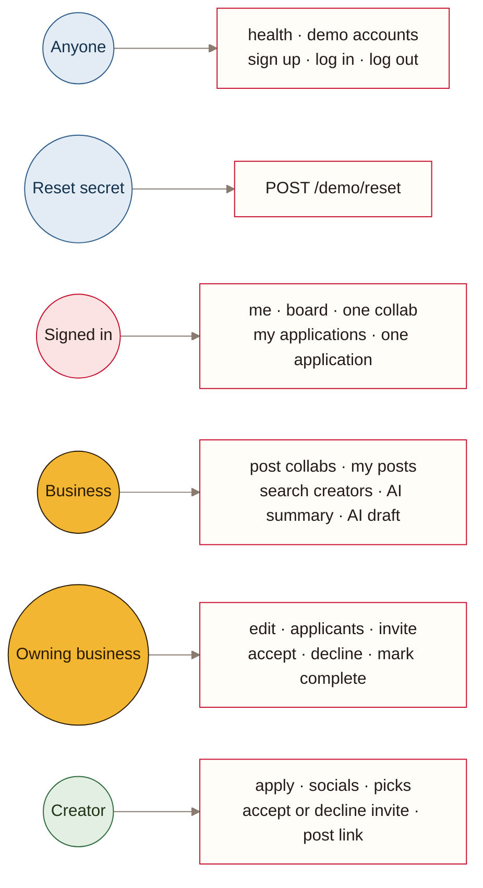
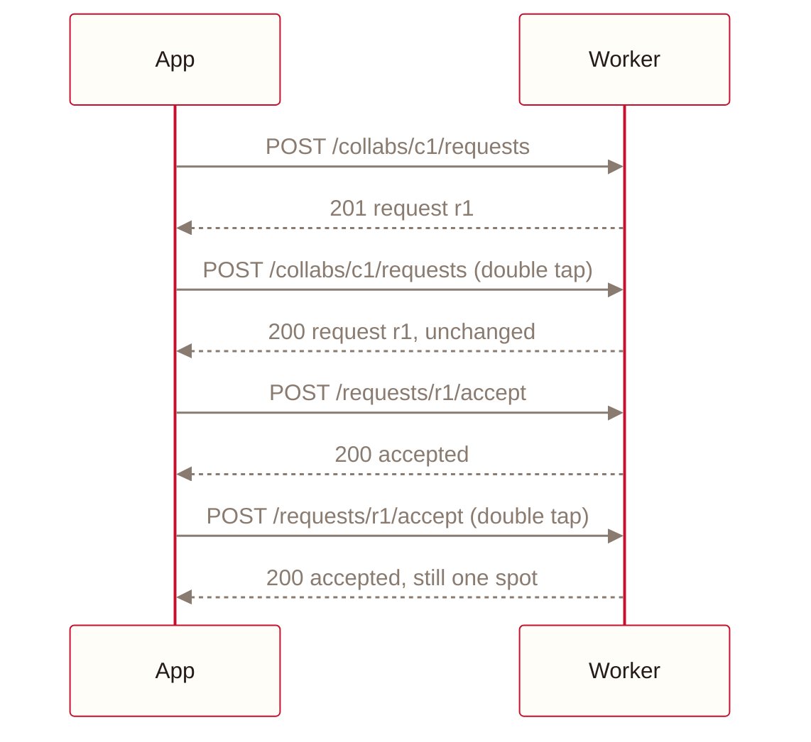

#  API reference

| | |
|---|---|
| **Product** | Collab Board |
| **Purpose** | Every endpoint, who may call it, and the errors it returns |
| **Audience** | Engineering, QA, integrators |
| **Version** | 1.0, 2 November 2026 |
| **Owner** | Abdulla Alasmawi |
| **Related** | [Executive summary](executive-summary.md) · [Docs index](README.md) |


Every endpoint is under `/api/v1` and speaks JSON. Requests are identified by the `cb_session` cookie that login sets. Types for every response are in `src/shared/api.ts`, and request schemas are in `src/shared/schemas.ts`.

## 1. Access control




## 2. Endpoints

| Method | Path | Who | Does |
|---|---|---|---|
| GET | `/health` | Anyone | Confirms the database schema is current. 503 if a migration was skipped |
| GET | `/demo/accounts` | Anyone | Lists demo accounts, and seeds an empty database |
| POST | `/demo/reset` | Reset secret | Restores demo data. 404 without the `X-Reset-Token` header |
| POST | `/auth/signup` | Anyone | Creates a creator or business account and signs in |
| POST | `/auth/login` | Anyone | Signs in and sets the cookie |
| POST | `/auth/logout` | Anyone | Ends the session |
| GET | `/me` | Signed in | Your account |
| PUT | `/me/socials` | Creator | Replaces your socials |
| GET | `/collabs` | Signed in | The board |
| GET | `/collabs/:id` | Signed in | One collab, with your request on it if any |
| POST | `/collabs` | Business | Posts a collab |
| PUT | `/collabs/:id` | Owning business | Replaces a collab. Spots can't drop below those already taken |
| GET | `/business/collabs` | Business | Your posts, with counts |
| GET | `/collabs/:id/requests` | Owning business | Applicants and invites for a post |
| POST | `/collabs/:id/requests` | Creator | Applies with one line |
| POST | `/collabs/:id/invites` | Owning business | Invites a creator |
| GET | `/me/picks` | Creator | Up to 3 collabs picked for you, with plain reasons and any AI reasons saved today. Costs no AI |
| POST | `/me/picks/explain` | Creator | Asks the AI once a day to reword today's reasons; saved, including failures |
| GET | `/me/requests` | Signed in | Your applications and invites |
| GET | `/requests/:id` | Its creator or the owning business | One application |
| POST | `/requests/:id/accept` | Owning business | Accepts, if a spot is free and the collab hasn't ended |
| POST | `/requests/:id/decline` | Owning business | Declines |
| POST | `/requests/:id/accept-invite` | Invited creator | Accepts an invite, under the same spot rule |
| POST | `/requests/:id/decline-invite` | Invited creator | Declines an invite |
| POST | `/requests/:id/submission` | Accepted creator | Adds or fixes the post link |
| POST | `/requests/:id/complete` | Owning business | Marks a posted collab complete |
| GET | `/creators?q=` | Business | Searches creators, 30 results at most |
| POST | `/creators/:id/summary` | Business | Writes and saves an AI summary |
| POST | `/ai/draft-collab` | Business | Turns one sentence into a draft collab |


## 3. Errors

Every error has the same shape:

```json
{ "error": { "code": "COLLAB_FULL", "message": "This collab has no spots left." } }
```

| Status | Codes | When |
|---|---|---|
| Code | When |
|---|---|
| `NOT_SIGNED_IN` | No valid session |
| `WRONG_LOGIN` | The username or password is wrong |
| `USERNAME_TAKEN` | Sign-up with a username already in use |
| `FORBIDDEN` | The wrong role, or not your collab |
| `NOT_FOUND` | Missing, or the reset secret is wrong |
| `VALIDATION_FAILED` | A field failed its schema. `fields` maps each field to a message |
| `INVALID_TRANSITION` | A status change that isn't allowed, such as completing an application nobody posted for |
| `COLLAB_FULL` | The last spot was just taken |
| `COLLAB_ENDED` | The collab's end date has passed |
| `SPOTS_BELOW_TAKEN` | An edit would leave fewer spots than creators already accepted |
| `SCHEMA_OUT_OF_DATE` | The deploy skipped a migration |
| `UNEXPECTED` | Anything else. The details stay in the Worker's logs |

`ErrorCode` in `src/shared/api.ts` is the full list, and `src/worker/http/errors.ts` sets each HTTP status.


## 4. Idempotency



> [!TIP]
> Applying, accepting and inviting twice return the first result, so a double tap never shows an error.
