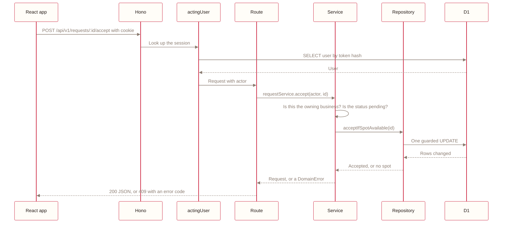
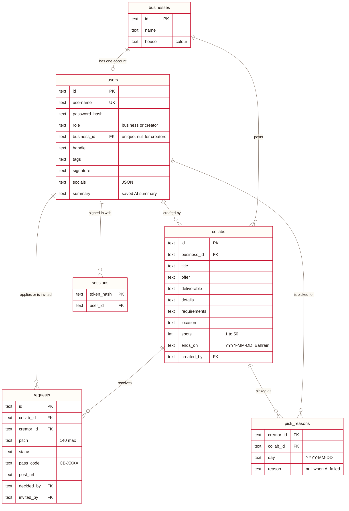
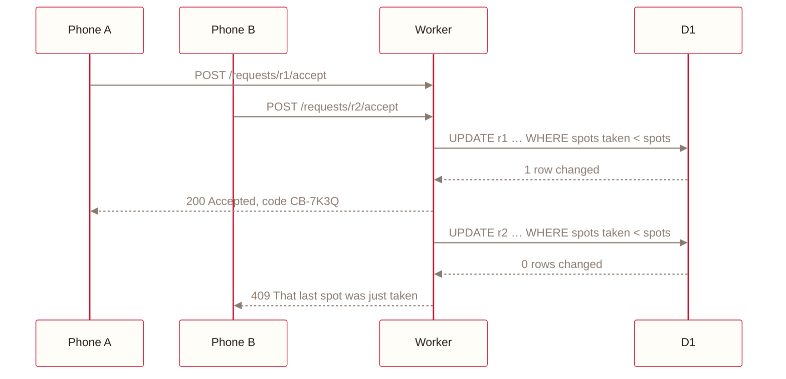
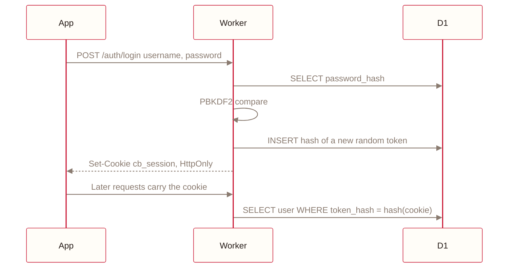
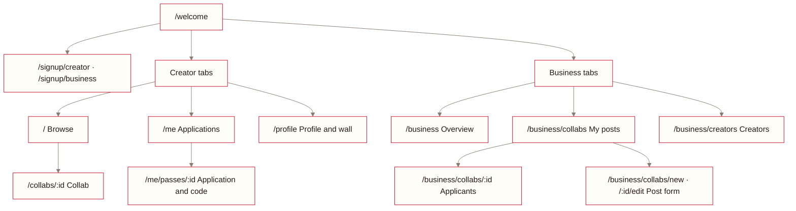

#  Architecture

| | |
|---|---|
| **Product** | Collab Board |
| **Purpose** | How Collab Board is built: components, stack, request protection, data, AI, delivery and known limits |
| **Audience** | Engineering, Security, technical reviewers |
| **Version** | 1.0, 2 November 2026 |
| **Owner** | Abdulla Alasmawi |
| **Related** | [Executive summary](executive-summary.md) · [Docs index](README.md) |

How Collab Board is built, how each request is protected, where data goes, and how it ships. Each
section answers the questions a technical reviewer is likely to ask.

## 1. System overview

One Cloudflare Worker serves both the app and the API from one URL. `wrangler.jsonc` sends `/api/*` to
the Worker first; every other path is the built React app, which falls back to `index.html`.

| Component | Technology | Responsibility |
|---|---|---|
| Router | `wrangler.jsonc` `run_worker_first: ["/api/*"]` | API paths reach the Worker; everything else is the app, falling back to `index.html` |
| SPA | React 19, React Router 7, TanStack Query 5 | Screens, caching, loading and error states, preview states |
| Hono app | Hono 4 | Routing under `/api/v1`, security headers, one error shape |
| actingUser | `src/worker/http/actingUser.ts` | Turns the session cookie into a user, or refuses with `NOT_SIGNED_IN` |
| Routes | `src/worker/routes` | Validate input with Zod, call one service, return JSON |
| Services | `src/worker/services` | Permissions by role and ownership, allowed status changes |
| Repositories | `src/worker/repositories` | All SQL, including the single-statement spot guards |
| AI module | `src/worker/ai` | Model calls with a timeout; only fields that pass their schema survive |
| D1 | Cloudflare D1 (SQLite) | Accounts, sessions, collabs, requests, demo metadata |
| Workers AI | `llama-3.3-70b-instruct-fp8-fast` | Post drafts and creator summaries |
| Secret | `DEMO_RESET_TOKEN` | Required to reset the demo |
| Delivery | GitHub Actions, wrangler | Checks, then migrations before the new version |

## 2. Technology stack

| | Layer | Technology | Why this choice |
|---|---|---|---|
|  | Hosting | Cloudflare Workers with static assets | One deploy and one URL for the app and the API, on the free plan |
|  | Database | Cloudflare D1 (SQLite) | One SQL statement is atomic, which the spot guarantee relies on |
|  | AI | Workers AI, `llama-3.3-70b-instruct-fp8-fast` | JSON mode for drafts; runs inside Cloudflare, no extra vendor |
|  | API | Hono 4 | Small, typed routing built for Workers |
|  | Validation | Zod 4 | One schema validates the request on the server and the form in the browser |
|  | Screens | React 19 | Component model the team knows |
|  | Navigation | React Router 7 | One file per screen, deep links work |
|  | Data in the app | TanStack Query 5 | Caching, refetching, loading and error states |
|  | Build | Vite 8 with `@cloudflare/vite-plugin` | Runs the real Worker and D1 locally |
|  | Language | TypeScript 5.9 | Types shared between the app and the API |
|  | Tests | Vitest 5 with `@cloudflare/vitest-plugin` | Tests run in the real Workers runtime against real D1 |
|  | Lint | ESLint 10 with typescript-eslint | |
|  | CI | GitHub Actions | Checks every push; deploys `main` |

Runtime dependencies: 9. `npm audit --omit=dev` reported 0 known vulnerabilities on 3 November 2026.

## 3. Request protection

| Step | Control | Where | Stops |
|---|---|---|---|
| 1. Edge | HTTPS on `workers.dev` | Cloudflare | Eavesdropping |
| 2. Headers | CSP limited to the site's origin, `X-Frame-Options: DENY`, `nosniff`, referrer and permissions policies | `public/_headers`, `secureHeaders()` | Clickjacking, injected scripts |
| 3. Session | Random token in an `HttpOnly`, `SameSite=Lax` cookie, `Secure` over https; SHA-256 hash stored | `src/worker/auth/sessions.ts` | Script access to the cookie, cross-site form posts |
| 4. Validation | A Zod schema per route; 422 with per-field messages | `src/shared/schemas.ts` | Malformed or oversized input |
| 5. Permission | Role and ownership checked in the services | `src/worker/services/permissions.ts` | Acting on another business's collabs |
| 6. Data | Bound parameters only; guarded single-statement writes | `src/worker/repositories` | SQL injection, overbooking |

> [!CAUTION]
> Demo strength by design: 10,000 PBKDF2 rounds to fit the CPU limit, sessions that expire only with
> the 30-day cookie, and no login rate limit. See [Known limits](#12-known-limits).

## 4. Code layers

| Layer | Folder | Does | Never does |
|---|---|---|---|
| Routes | `src/worker/routes` | Reads the request, validates it with Zod, calls one service, returns JSON | Rules or SQL |
| Services | `src/worker/services` | Who may do what, which status changes are allowed, what errors mean | SQL or HTTP |
| Repositories | `src/worker/repositories` | SQL, including the single-statement guards | Decide permissions |
| AI | `src/worker/ai` | Calls the model with a timeout and keeps only fields that pass their schema | Publish without a person's review |
| Shared | `src/shared` | Types, schemas, statuses, dates and labels used by both sides | Import from the Worker or the app |
| App | `src/web` | Screens, features, components and design tokens | Trust its own checks |

## 5. Request lifecycle

## 6. Data model

| Table | Holds |
|---|---|
| `businesses` | Name and colour ("house") |
| `users` | One row per account. A unique index allows one per business |
| `sessions` | Hashes of session tokens. The cookie holds the token, the database only its hash |
| `collabs` | A business's post |
| `requests` | An application or an invite, with status, line, code and post link. One per creator per collab |
| `pick_reasons` | AI reasons for Picked for you, per creator, collab and day. A null reason marks an AI failure, so it isn't retried |
| `demo_meta` | When the demo was last reset |

Spots taken, spots left, and whether a collab is open, full or ended are worked out when read, never
stored. A check constraint makes every status from Accepted onward carry a code.

## 7. Spot guarantee

A collab never accepts more creators than it has spots, even with a double tap or two phones at once.

The count and the update are one SQL statement in `requestsRepo.acceptIfSpotAvailable`, and D1 runs
one write at a time, so nothing can slip between them. Accepting an invite, applying and lowering the
spots on a post use the same pattern. The tests were checked by swapping the guard for "SELECT, then
UPDATE" and confirming that they fail.

## 8. Authentication and sessions

Password hashing uses 10,000 rounds of PBKDF2 to fit the free plan's CPU limit: fine for a demo, too
light for real accounts. The server doesn't expire sessions on its own; they end at logout or when the
30-day cookie expires.

## 9. AI

| | Post draft | Creator summary | Picked for you |
|---|---|---|---|
| Who | Business | Business | Creator |
| Input to the model | The sentence the business typed (300 characters at most) | Name, tags, one line and completed count | The creator's tags and line, and the title, offer and deliverable of up to 3 collabs code already picked |
| Controls | JSON mode, 300 output tokens, 8-second timeout, each field parsed on its own, `<` or `>` dropped | Facts passed as data, not instructions; answers with markup or links discarded | Code ranks and chooses; the model only rewords. Reasons of 20 to 90 characters, no markup or links, unknown ids ignored |
| If it fails | The form is filled by hand; Skip is always visible | The plain fact line stays | The plain reason stays, and the failure is saved so it isn't retried that day |
| Cost | Free daily allowance of 10,000 neurons | About 33 neurons each, saved so repeat views cost nothing | One call per creator per day, saved; at most 9 reasons a creator a day |

Nothing the model returns is published without a person reviewing it.

## 10. Delivery

| Stage | What runs | Fails when |
|---|---|---|
| Check | `npm run typecheck`, `npm run lint`, `npm test` (265 tests) | Any type error, lint error or failing test |
| Build | `vite build` | The app doesn't compile |
| Release | `wrangler d1 migrations apply DB --remote`, then `wrangler deploy` | A migration fails, so the new code never ships |
| Verify | `GET /api/v1/health` | The schema doesn't match the code (503) |

Rollback: `npx wrangler rollback` restores the previous Worker version. Migrations only move forward, so
a schema change is undone with a new migration. [Operations](operations.md) has the commands.

## 11. Front-end structure

| Folder | Holds |
|---|---|
| `src/web/routes` | One file per screen |
| `src/web/features` | Pieces used by a few screens: cards, sheets, rings, the AI draft |
| `src/web/components` | Shared pieces: layout, stamps, brand marks, states, sheets |
| `src/web/api` | The API client, TanStack Query hooks and preview states |
| `src/web/design` | Tokens, styles and touch feedback |

## 12. Known limits

| Limit | Impact | Fix before real use |
|---|---|---|
| PBKDF2 at 10,000 rounds | Weak against offline cracking if the database leaks | Raise rounds or move hashing off the request path |
| No server-side session expiry | A stolen cookie works until logout | Expire sessions by age and rotate on sign-in |
| No login rate limit | Passwords can be guessed repeatedly | Rate limit by account and IP |
| No account deletion | Can't honour deletion requests | Add deletion that removes the user's rows |
| Visit code checked by eye | A shared screenshot could be reused | Let the business confirm the code in the app |
| Free-plan limits | Heavy use could hit daily limits | Move to a paid plan if usage grows |
