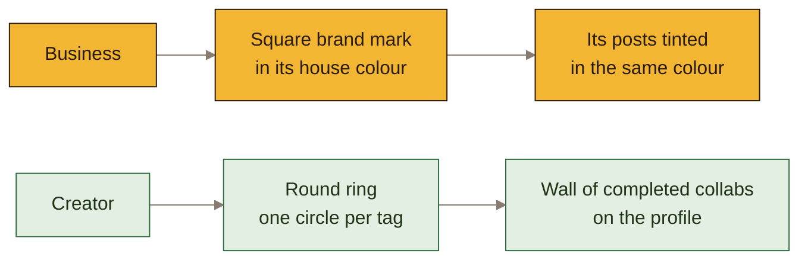
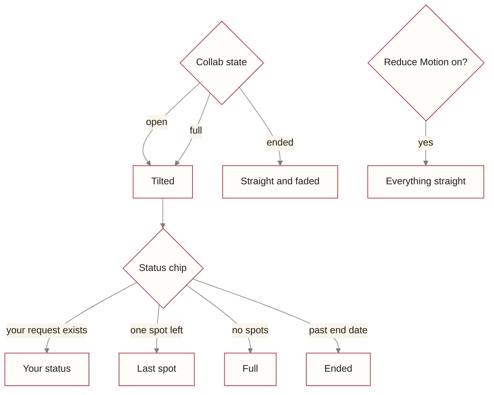
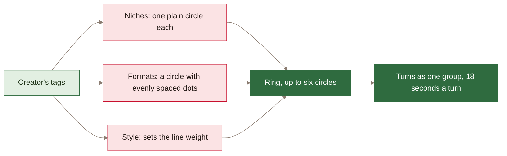

#  Design

The visual system: the board, tokens, rings, screens, motion and layout.

Cream and red, native on a phone, drawn as stickers: thick ink outlines, hard offset shadows, rounded corners and pill chips. [DECISIONS.md](../DECISIONS.md) explains the reasons behind each piece.

## 1. Identity

> [!IMPORTANT]
> A business is always a square and a creator always a round ring, on every screen. That's the one
> rule that keeps the two sides apart.

## 2. The board

| Piece | What it looks like | Where | In the code |
|---|---|---|---|
| Sticker | A rounded card in a soft tint of the business's colour, with a 2.5px ink outline and a hard ink shadow that drops away when pressed | Every post, pick and wall card; buttons, stats and lists share the outline | `--edge` and `--shadow-*` in the depth section of `app.css` |
| Tilt | Live cards lean by a degree or so | Browse, the profile wall, the code card | `rotate: var(--tilt)`, set by `tiltStyle(id)` |
| Status chips | An ink-outlined pill tinted in the status colour | Cards, the action bar, the code card, the wall | `src/web/components/Stamp.tsx` |
| Wall | Completed collabs pinned two across, plus a slot for the next | Creator's Profile | `.wall` in `app.css`, `Profile.tsx` |

A card's lean comes from a hash of its id, so it's the same on every visit and the board never jumps.

| Status chip | Tint |
|---|---|
| Invited, Accepted, Last spot | Red |
| Applied | Green |
| Posted | Blue |
| Completed | Ink |
| Declined, Full, Ended | Grey |

## 3. Design tokens

All in `src/web/design/tokens.css`.

| Token | Value | Use |
|---|---|---|
| `--cream` | `#faf5ea` | Page background |
| `--surface` | `#fffdf8` | Cards and sheets |
| `--surface-sunk` | `#f2eadb` | Pressed rows, tracks |
| `--line` | `#e6dccb` | Row dividers inside lists |
| `--edge` | `2.5px solid var(--ink)` | The sticker outline |
| `--shadow-sm` / `-md` / `-lg` | `3px` / `4px` / `6px` ink, no blur | Buttons / cards / sheets |
| `--ink` | `#241a16` | Text |
| `--ink-soft` | `#66594f` | Secondary text, grey chips |
| `--red` | `#c8102e` | Primary actions and red chips |
| `--green` | `#2f6b3f` | Applied chip |
| `--blue` | `#2f5f8a` | Posted chip |
| `--font-title` | Ultra | Titles only |
| `--font` | Archivo | All other text |
| `--font-mono` | JetBrains Mono | Codes like `CB-7K3Q` |

The five business colours are the `.house--*` classes in `app.css`: saffron, gulf, sage, oud and
coral. Each pairs a background with an ink colour that stays readable on it.

## 4. Creator rings

Two creators with the same tags get the same ring. The dots are what make the turning visible.

## 5. Screen inventory

| Creator | Business |
|---|---|
| Browse: the board of collabs | Overview: stats, decisions, ending soon, creators to invite |
| Collab: details, Apply | My posts: live and ended |
| Applications: grouped by status | Applicants: accept, decline, mark complete |
| Application: four steps, code, post link | Post form, with the AI sparkle |
| Profile: ring, stats, wall, socials | Creators: search, AI summary, invite |

Every screen has loading, empty and error states. The account sheet's preview states show them on
demand, with a banner so they can't pass for real failures.

## 6. Motion and layout

- Screens ease in, lists arrive in sequence, and controls answer touch. Only the rings loop.
- Reduce Motion turns all motion off and sets every card straight.
- Phones get one column. From 960px, detail screens split into two columns with a side rail, and lists
  go two across. Every screen is checked at 320, 360, 390, 768 and 1280px.
