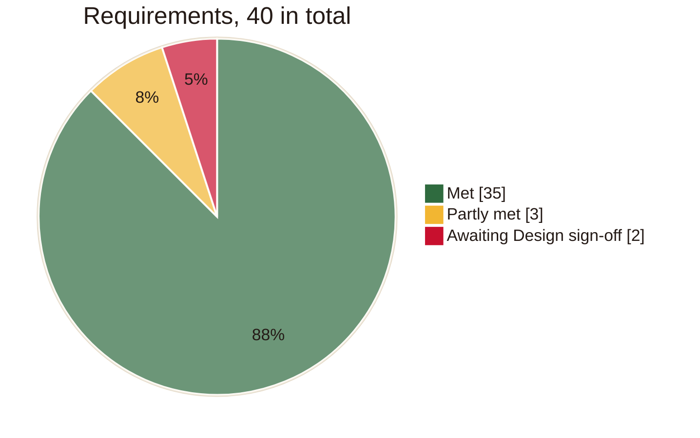

#  Executive summary

| | |
|---|---|
| **Product** | Collab Board |
| **Document** | Executive summary |
| **Audience** | Leadership, Product, Legal and anyone deciding whether to take it further |
| **Version** | 1.0, 2 November 2026 |
| **Owner** | Abdulla Alasmawi |
| **Live** | https://collab-board.alasmawi.workers.dev |

## 1. Summary

Collab Board connects local businesses with content creators. A business posts a collab: something it
offers, such as a meal, a class or a product, in exchange for a post. Creators apply from their
phones, the business accepts the ones it wants, the creator visits and posts, and the business marks
it complete.

> [!TIP]
> **Live, at no running cost, and 37 of 40 requirements met.** CI runs green on GitHub. The remaining
> three need a real-phone test and Design's sign-off.

## 2. How it creates value

| For | Value |
|---|---|
| Businesses | Content and reach from local creators, without agencies or direct messages. Full control over who is accepted and how many |
| Creators | A steady supply of real offers, applied for in one line, and a visible record of completed work |
| The operator | A working product at no running cost, built so the core rule can't be broken |

## 3. What it does today

| Capability | Status |
|---|---|
| Business and creator sign-up, one account per business | Live |
| Post and edit collabs, with AI filling the form from one sentence | Live |
| Browse, apply, invite, accept and decline | Live |
| Visit code, post link and completion | Live |
| Creator search with AI summaries | Live |
| Picked for you: collabs matched to each creator, with AI reasons | Built, not yet deployed |
| Never more creators than spots, under any timing | Live and tested |
| Works on phone, tablet and desktop | Live, simulated only |

## 4. Status

| Before review | Owner |
|---|---|
| Test on a real iPhone and Android phone | QA |
| Push to GitHub so CI runs for the first time | Engineering |
| Sign off the look and the font | Design |

## 5. Cost

| Item | Monthly cost | Limit it stays inside |
|---|---|---|
| Hosting and API (Cloudflare Workers) | 0 | 100,000 requests a day |
| Database (Cloudflare D1) | 0 | 5 million rows read a day |
| AI (Workers AI) | 0 | 10,000 neurons a day; about 33 per summary |

If the AI allowance runs out, the app keeps working: summaries fall back to plain facts and posts are
filled in by hand.

## 6. Risks

| Risk | Impact | Mitigation |
|---|---|---|
| Built as a demo: light password hashing, no password reset or login limits | Not fit for real accounts yet | Listed for change before real use |
| No privacy policy, terms or account deletion | Can't hold real people's details yet | Needed before launch |
| Never tested on a physical phone | Reviewers may hit device issues | Real-device test before review |
| Free AI allowance shared by all users | Summaries and drafts may pause in heavy use | Falls back to plain forms; a per-user limit is planned |

## 7. Recommended next steps

1. Open the live link on a real phone, and set the Cloudflare secrets so CI deploys.
2. Get Design's sign-off.
3. Decide the three open product questions: releasing a no-show's spot, re-applying after a decline,
   and showing full posts.
4. Before real users: proper account security, privacy policy and terms, and account deletion.

Further detail: [Product](product.md), [Architecture](architecture.md), and
[AUDIT.md](../AUDIT.md) for every requirement and its evidence.
