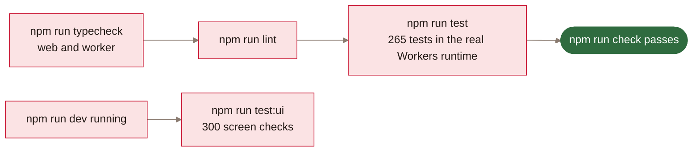
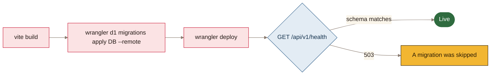
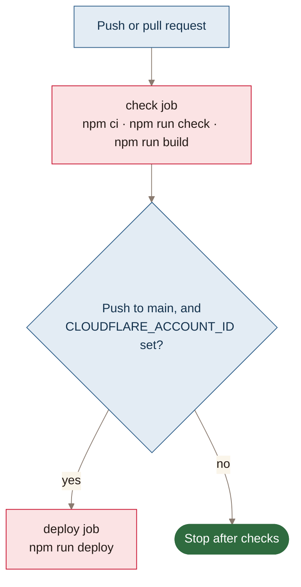
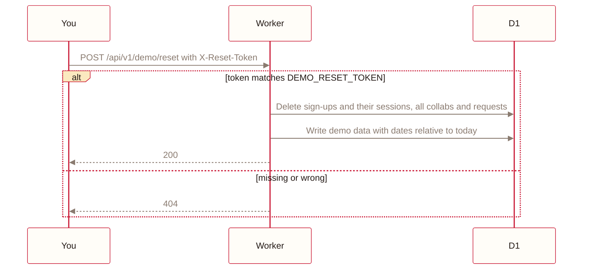

#  Operations

| | |
|---|---|
| **Product** | Collab Board |
| **Purpose** | How to run, test, deploy and reset Collab Board, and the limits it runs within |
| **Audience** | Engineering, operations |
| **Version** | 1.0, 2 November 2026 |
| **Owner** | Abdulla Alasmawi |
| **Related** | [Executive summary](executive-summary.md) · [Docs index](README.md) |


How to run, test, deploy and reset Collab Board.

## 1. Running locally

Needs Node 22 or newer. No Cloudflare account is needed: without one, AI falls back to plain forms
and plain facts.

```bash
npm install
```

```bash
npm run dev
```

This applies migrations to a local D1 database and serves the app and API on http://localhost:5173.

| Command | Does |
|---|---|
| `npm run dev` | Local D1 and the app |
| `npm run dev:phone` | The same, reachable from a phone on your Wi-Fi |
| `npm run dev:ai` | Uses the real Workers AI model. Needs `npx wrangler login` |
| `npm run db:migrate` | Applies migrations to the local database |


## 2. Verification



| Command | Proves |
|---|---|
| `npm run check` | Types, lint and 265 tests against real D1, including the spot race with the guard deliberately broken |
| `npm run test:ui` | Every screen at 320, 360, 390, 768 and 1280px in every preview state, with no sideways scroll |
| `npm run test:webkit` | iPhone SE, 15 and 15 Pro Max in WebKit, Safari's engine, with touch: no sideways scroll, no input zoom, big enough tap targets, bottom bars in view. Reads the live site by default; `BASE_URL=http://localhost:5173 MUTATE=1` also taps through an application |

`test:ui` drives your installed Chrome and resets the demo first, so it needs the reset secret in
`.dev.vars`. Don't point it at a site where real people have signed up. `test:webkit` needs WebKit once:
`npx playwright-core install webkit`.


## 3. Deployment



One-time setup, from a machine logged in with `npx wrangler login`:

1. Register a `workers.dev` subdomain in the Cloudflare dashboard.
2. Run `npx wrangler d1 create collab-board` and put its name and id in `wrangler.jsonc`.
3. Set the reset secret with `npx wrangler secret put DEMO_RESET_TOKEN`.

Then each time:

```bash
npm run deploy
```

> [!NOTE]
> `npm run deploy` builds, applies any new migrations to the live database, then deploys. Migrations
> run before the new code, so the new code never meets an old schema.

 `/api/v1/health` reports the schema it found.


## 4. Continuous integration



To deploy from GitHub Actions, add the secret `CLOUDFLARE_API_TOKEN` and the repository variable
`CLOUDFLARE_ACCOUNT_ID`. The reset secret lives on Cloudflare, so deploys keep it.


## 5. Demo reset

> [!WARNING]
> Resetting restores the sample data and removes everyone who signed up, so it isn't on any screen.
> Check for real sign-ups before resetting a live site.



Locally, put the secret in `.dev.vars` (it's git-ignored):

```
DEMO_RESET_TOKEN=any-long-random-value
```

Then reset:

```bash
curl -X POST -H "X-Reset-Token: $DEMO_RESET_TOKEN" http://localhost:5173/api/v1/demo/reset
```

For the live site, use the same command against https://collab-board.alasmawi.workers.dev with the
secret set on Cloudflare.


## 6. Database migrations

| File | Changed |
|---|---|
| `0001_init.sql` | Businesses, users, collabs, requests, sessions and demo_meta |
| `0002_socials_and_post_details.sql` | Creator socials; optional details, who they're looking for and location on collabs |
| `0003_one_account_per_business_no_offers.sql` | One account per business; offers removed |
| `0004_no_business_type_or_area.sql` | Business type and area removed |
| `0005_pick_reasons.sql` | Saved AI reasons for Picked for you |

Add a new migration as the next numbered file, then update `SCHEMA_VERSION` in
`src/worker/routes/public.ts` and the matching test in `test/demo.test.ts`.


## 7. Platform limits

| Limit | How the app stays inside it |
|---|---|
| 10 ms CPU per request | Rings and logos are drawn in the browser. Password hashing is light |
| 100k requests, 5M rows read and 100k written a day | Search waits for a pause in typing and returns 30 results at most |
| 10k AI neurons a day | About 33 neurons a summary, and one call per creator a day for pick reasons. Each is saved, and plain facts need no AI |

When the AI allowance runs out the app keeps working: summaries stay as plain facts, and posts are
filled in by hand.
