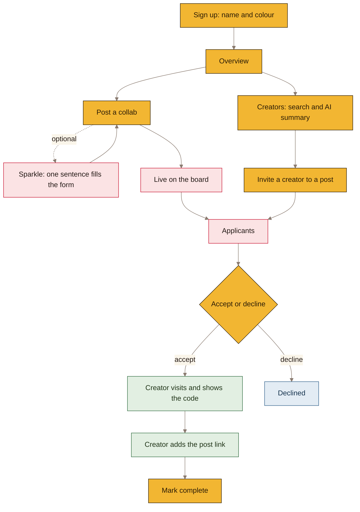
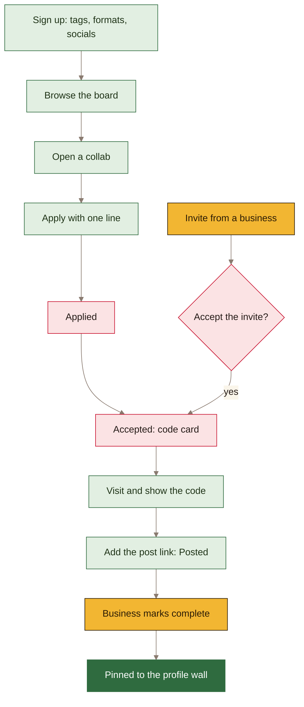
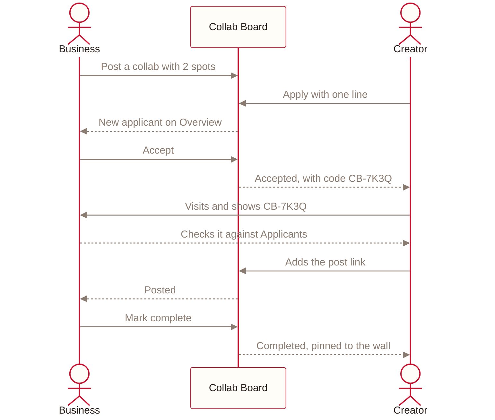
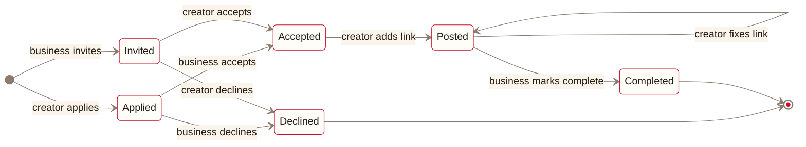
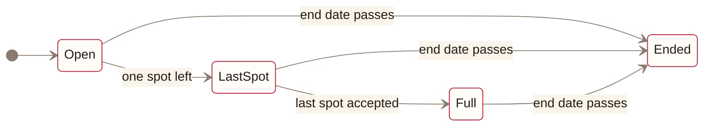

#  Product

What Collab Board does: the two sides, journeys, statuses, rules and AI features.

## 1. Users

| | Businesses | Creators |
|---|---|---|
| Who | Cafés, shops, gyms and so on | People who post on Instagram, TikTok and similar |
| Shown as | A square in the business's colour | A round ring drawn from their tags |
| Account | One per business, named after it | One per person |
| Signs up with | Name, colour, username, password | Tags, formats, style, name, handle, one line, socials |
| Does | Posts collabs, reviews applicants, invites creators, marks posts complete | Browses, applies, visits, adds the post link |
| Tabs | Overview, My posts, Creators | Browse, Applications, Profile |

A **collab** offers something (a meal, a class, a product) in exchange for content. It has a title,
what's offered, what to post, a number of spots and an end date, plus optional details, who they're
looking for and a location.

## 2. Business journey

## 3. Creator journey

## 4. End-to-end flow

## 5. Application statuses

| Stamp | In the code | Means | Next step |
|---|---|---|---|
| Applied | `pending` | The creator applied | The business accepts or declines |
| Invited | `invited` | The business invited the creator | The creator accepts or declines |
| Accepted | `accepted` | A spot is held and a code is issued | The creator visits and shows the code |
| Posted | `submitted` | The creator added an https post link | The business marks it complete |
| Completed | `done` | Finished | Pinned to the creator's wall |
| Declined | `declined` | Turned down by either side | None |

A collab is **Last spot** with one spot left, **Full** when every spot is taken, and **Ended** after
its end date. These are worked out when read and never stored.

## 6. Business rules

> [!IMPORTANT]
> **Never more creators than spots,** even with a double tap or two phones at once. This is the
> one rule the whole design protects; see [Architecture §7](architecture.md#7-spot-guarantee).

- **One account per business.** Two phones on the same account are handled like two people.
- **Invites hold no spot.** More can go out than there are spots; the first to accept get them.
- **Ended means closed.** Accepting after the end date is refused. Decline still works.
- **Double taps are harmless.** Applying, accepting and inviting twice return the first result.
- **One request per creator per collab.** A declined creator can't apply to the same collab again.
- **A spot stays taken once given.** There's no releasing a no-show in this version.
- **The visit code** lets the business confirm the person at the counter was accepted. Staff
  compare it by eye.

| Field | Limit |
|---|---|
| Title | 80 characters |
| What's offered | 400 characters |
| What to post | 500 characters |
| About, who they're looking for, location | Optional: 1,000, 500 and 80 characters |
| Spots | 1 to 50 |
| Application line | 140 characters |
| Post link | https only, 500 characters |
| AI sentence | 300 characters |

## 7. AI features

| Feature | Who | What happens | If AI is unavailable |
|---|---|---|---|
| Fill the post form | Business | One sentence becomes a draft the business edits before publishing | The form is filled by hand |
| Creator summary | Business | A short summary written from the creator's facts, then saved | A plain line of facts |
| Picked for you | Creator | Code picks up to 3 open collabs that fit the creator's tags; the AI rewrites each reason once a day | The plain reason, such as "Fits your Coffee and Reels · 2 spots left · ends tomorrow" |

Skip is always visible, drafts time out after 8 seconds, and only fields that pass their checks are
kept. A draft is never published without the business reviewing it.
